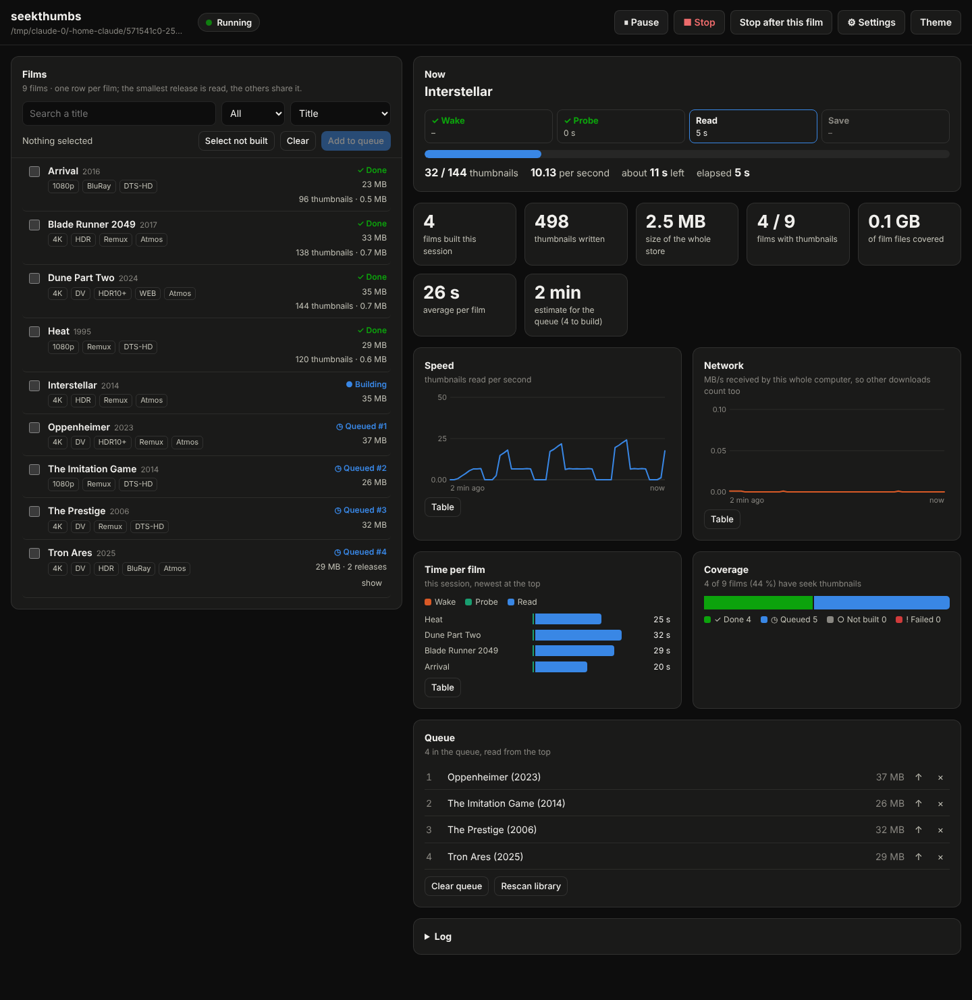

# seekthumbs: seek-bar thumbnails for an rclone library


*Illustration, not a screenshot: the film frames are made up, and the hover preview has since been confirmed in real mpv with uosc on a finished film (2026-10-27); the on-play trigger has not (see "Open items" below).*

> **Part of the [Software Defined Home Theatre](https://github.com/praveenchandrahas/Software-Defined-Home-Theatre) project.** The main repository holds the documentation, build log, results and the installer checks; this is one of its parts. Sibling repositories: [linux-theater-dsp](https://github.com/praveenchandrahas/linux-theater-dsp) (router and CamillaDSP configs) · [mpv-object-audio](https://github.com/praveenchandrahas/mpv-object-audio) (player and Atmos wrapper) · [Roomtone](https://github.com/praveenchandrahas/Roomtone) (measurement, autocal, status page, mpv overlay) · [mpv-shelf](https://github.com/praveenchandrahas/mpv-shelf) (film browser for mpv).

Netflix-style previews on the mpv seek bar (called *trickplay* or *seek thumbnails*), for a film library on a **read-only rclone mount**.
The thumbnails are made in the background and kept in a **local folder**; the library is only ever read.

State (2026-10-27): generator (parallel, adaptive), on-play build, one set per film across releases, watcher, a local web page to pick and run films, cold-file handling, mpv viewer and tests are written and pass on synthetic
films. **The hover preview works in real mpv with uosc** (owner, 2026-10-27, on a film whose thumbnails were already built); **the on-play trigger has not yet been reported from real mpv** (the sandbox has neither). The generator has been probed on the owner's
debrid mount (numbers below). Open items are listed at the end.

**Three ways to get thumbnails, use any of them:** (0) *the web page* (`./seekthumbs.py serve`): tick the films you want, press Start, watch the speed and the progress (see below); (1) *on play* (the default once `install-viewer` has run): the first time you play a film that has none, the viewer starts a
gentle background build of that one film; (2) *batch*: `scan` / `watch` build the whole library ahead of time. In both, releases of the same film share one set (see below).

## Setup (once the paths are known)

```bash
sudo apt install python3-av                      # recommended: opens each film once instead of once per thumbnail (see "Speed"); the pip wheel lacks zscale (HDR)
mkdir -p ~/.config/seekthumbs
cat > ~/.config/seekthumbs/config.ini <<'INI'
[seekthumbs]
library = /path/to/the/rclone/mount/Movies
store   = /path/to/local/thumbnail/folder
INI
cd seekthumbs      # this repository
./seekthumbs.py probe "/path/to/one/film.mkv"     # seconds and MB received per thumbnail for each extractor, and the projected time for 100 such films
./seekthumbs.py plan                              # lists what would be built (directory listings only)
./seekthumbs.py scan --max-films 1                # build one film, look at the result (settings work before or after the subcommand)
./seekthumbs.py build "/path/to/one/film.mkv"     # what the viewer starts when you play a film with no thumbnails: one film, low priority, 2 reads at a time
./seekthumbs.py scan                              # the whole library, as fast as the mount allows (run it overnight; Ctrl+C is safe, it resumes)
./seekthumbs.py status                            # size per 2 h against the 10 MB budget
./seekthumbs.py install-service --enable          # afterwards: the background watcher picks up new films (systemd user service)
./seekthumbs.py install-viewer                    # the mpv side, into ~/.config/mpv-object-audio/scripts (see below); also records where seekthumbs.py is, for the on-play build
```

`min_size_mb` (default 300; the owner sets 20000 in `config.ini`) decides which files count as films: **everything smaller is ignored, by `plan`/`scan`/`watch`, by `build`
and by the viewer's on-play check alike** (the viewer reads the same `config.ini` value and passes it to the build). At 20000 that excludes all 1080p encodes under 20 GB,
DVD rips, documentaries and sample clips; such films never get thumbnails. Non-video files (`.iso`, `.rar`, `.nfo`, ...) are never considered whatever their size.

## The web page: pick the films yourself


**One release is read per film.** The page reads the smallest release of a film in full. Every other release of that film can only become an alias (a few seconds), and only if its runtime is within `share_tolerance` (2 s) of one already built; otherwise the page logs `left out ...` and leaves it alone, and that release gets its own set when you play it. A film counts as Done once any release has a set; the release list shows which ones do. (Found on 2026-10-27: a film with 8 releases, e.g. Avengers Endgame, was being read in full once per release whose runtime differed by more than 2 s, at ~13 min each.) The command-line `scan` still builds a release with a different runtime separately, as a different cut; it does not use this rule.
```bash
./seekthumbs.py serve            # prints an address with a one-time token; open it in your browser (add --open to do that for you)
```



*Screenshot of the page running on a small library of synthetic films (so the sizes and times are tiny).*

One row per film (its releases are grouped, and the smallest one is read); tick the ones you want, press **Add to queue**, then **Start**. The buttons:
**Pause** freezes the reads where they are and **Resume** carries on from the same thumbnail; **Stop** ends now and throws away the film being read (it goes back to the
top of the queue); **Stop after this film** finishes the current film and then stops. The settings pop-over changes the parallel reads, the rest after each read and
whether it waits while a player runs, from the next film on (nothing is written to your config). The panels show the phase of the film being read (wake, probe, read, save),
thumbnails per second, the network speed of the whole computer (so other downloads count), how long each finished film took and where the time went, the size of the
store, and how much of the library is covered. Every chart has a Table view, and the log is at the bottom.

It listens on 127.0.0.1 only and every request needs the token; the Host header must be this computer; the page cannot name a file, only pick films that seekthumbs itself
listed. It reads the library and writes the thumbnail store, nothing else. The queue is saved in the store (`.web-queue.json`), so closing the page keeps it. The film being read is recorded there too: if the page is killed mid-film (out of memory, power cut), the film comes back at the top of the queue on the next start (`RESUMED:` in the log) instead of being lost. Until 2026-10-28 the film in hand was dropped from the saved queue the moment it started, so it was lost after a kill. Do not run
`scan` or `watch` at the same time as a Start from the page (one film is never built twice, but the two would compete for the mount).

## How it works

- **Extraction:** one `ffprobe` per film, then one `ffmpeg` per thumbnail: `-ss <t> -i FILE -noaccurate_seek -frames:v 1`, so ffmpeg jumps to the
  nearest earlier keyframe and decodes only that frame. Default every **20 s** (360 per 2 h). Thumbnail *i* is the keyframe at or before `(i + 0.5) * interval`.
  HDR sources are tone-mapped to SDR with zscale/tonemap (untested on a real HDR file; Dolby Vision profile 5 will probably look wrong).
- **Storage:** `STORE/<path relative to the library>.seekthumbs/thumbs.pack` (the JPEGs back to back) and `index.json` (offsets, lengths, file size, interval,
  width/height, quality). Budget: at most `budget_mb` (10) per 2 h of film, aimed at 80 %; quality, then width, are lowered until it fits.
  `verify` flags anything over budget.
- **On play (the viewer starts a build):** when the playing file is a video under `library`, at least `min_size_mb`, and has no usable entry, `thumbfast.lua` runs
  `seekthumbs.py build FILE` through mpv's detached `run` (it never blocks mpv and finishes even if you stop watching), once per file per session. Until it is done
  nothing is shown and no error appears; every 10 s the viewer looks again and tells uosc as soon as the entry exists (hovering also re-checks, at most every 5 s).
  `build=no` in `script-opts/seekthumbs.conf` turns the trigger off; `install-viewer` writes `builder=<path of seekthumbs.py>` there (without it nothing is started).
  **The first play of a film has no thumbnails for the first minutes**; later plays do. The build is made to stay out of the way of the film that is playing:
  `nice 19` and idle I/O class, `play_workers` parallel reads (default 2), each worker resting `play_pause` seconds (default 2) after a read, the same rate-limit governor
  and circuit breaker as `scan`, a lock so two instances never build the same film, and it does **not** wait for players (that rule stays in `scan`/`watch`).
  It still competes for the same debrid link and bandwidth as the film. **It never falls back to one ffmpeg process per thumbnail**: if PyAV is not installed or its filter chain
  cannot be built (an HDR film needs a PyAV with `zscale`: the apt package `python3-av`, not the pip wheel), it logs why and skips the film (not recorded as a failure);
  `play_extractor=auto` (or `ffmpeg`) allows the fallback. One example, **from the owner's mount and not general**: on a 54 GB 4K DV/HDR10 remux the ffmpeg command read
  62.7 MB per thumbnail (22.3 GB per film) at 3.57 s each, PyAV 9.8 MB (3.5 GB per film) at 0.47 s each (6 workers).
- **One set per film across releases:** files are grouped by a key from the *file name*: the title (lower case, accents removed, `.`/`_`/`-` as spaces, leading `www.site.org - ` and
  `[group]` tags dropped) plus the 4-digit year, which is the last year-looking word before the first release tag (`2160p`, `WEB`, `REMUX`, `x265`, ...); a year in first position belongs to
  the title (`2001.A.Space.Odyssey.1968`). **Never grouped:** names without a year (many IMAX documentaries), TV episodes (`S01E02`, `1x05`), names where the only year comes after a tag,
  and titles that differ in any word (`Hope.2026...` and `Hopeu - Hope (2026)CZtit...` are two films to this program; that costs a second build, never a wrong picture). Before sharing,
  ffprobe reads the new release's runtime (a cheap header read) and it must be within `share_tolerance` (2 s) of the built one, else it gets its own set (an extended cut stays separate).
  The release that gets the alias is then a small `index.json` with `alias_of`; the viewer follows it (its own file size is checked, so a replaced file shows nothing; a broken link, a loop,
  or a target that was rebuilt since is ignored) and `status`, `verify` and `prune` understand aliases (`prune` never deletes a pack an alias still uses). Releases can differ by a few seconds of
  logos or cuts, so a shared thumbnail can be that much off; at 20 s spacing it is mostly not noticeable. `share=0` turns sharing off. Limits: siblings are found in the local store, so the
  first release is built (or aliased) before the others; if a real entry that others alias is itself rebuilt, those aliases stop resolving until their next build or play re-links them.
- **Batch passes group the same way:** `plan` and `scan` order the releases of one film together and build the **smallest file** of the group (the cheapest to read); `plan` marks it
  ("N releases share this") and marks the others "alias ... if its runtime agrees", and its summary counts films to build and releases that would only get an alias.
- **New films:** `watch` loops: list the library (directory listings only), queue films with no entry or whose **size changed**, newest first, build at most
  3 per pass, sleep `poll` (30 min). Files under 300 MB are ignored; files modified in the last 10 min are skipped.
  If the library folder is empty or missing the pass does nothing (a dead mount must not look like "all films deleted"). `prune` is manual (`--yes` to delete).
- **Speed first, brakes only when needed:** by default 6 reads run in parallel with no pauses (`workers`, `pause=0`, `film_pause=0`, `max_films=0` = all).
  A **governor** watches every read. If one fails with a rate-limit signal (text containing 429, 403, 503, "too many requests", "rate limit", "quota",
  "slow down", or a timeout), it halves the number of parallel reads and stops all new reads for a cool-down: 30 s, then 60, 120 ... up to 15 min. Further signals
  during the same cool-down count once. After 40 clean reads it raises the parallelism by one, back up to `workers`. If the mount still says "slow down" after
  8 cool-downs in a row at a single read at a time (about an hour), the pass stops and all work pauses for `breaker_hours`; the film is *not* marked bad.
  Other read failures (corrupt region, not a rate limit) are retried once; a film is abandoned if 6 reads fail and more fail than succeed, and is retried after
  6 h (doubling to 7 days). Three films in a row abandoned this way also pause everything for an hour. Still in force: `nice 19` and idle I/O class, a lock file
  against two instances, waiting (5 min steps) while mpv/vlc/kodi is playing, and one film at a time so the reads stay in one region of the mount.
- **Speed:** two extractors. `ffmpeg` runs one process per thumbnail (re-opens the film every time). `pyav` (PyAV) lets each worker open the film **once** and then
  only seek: it avoids the repeated open, probe and index reads, which on a network mount are the bulk of the round trips. `extractor=auto` (default) uses PyAV when it
  is installed and its filter chain builds, and falls back to the ffmpeg command otherwise (HDR films with a PyAV that lacks `zscale`, or a PyAV that fails 3 times
  before its first success). HDR frames are scaled to thumbnail size *before* tone-mapping, which makes the tone-map almost free. The JPEG encoding at the end runs in
  parallel. Measured on a local 30 min 1080p test file with 2 cores (no network, so no round-trip cost at all): ffmpeg command 2.8 reads/s, PyAV 100+ reads/s;
  a 4K 10-bit HDR thumbnail through the ffmpeg command took 0.7 s (software decode). **These are not numbers for your mount.**
- **What one real mount measured (the owner's debrid mount, 2026-10-27; one library, one evening, do not generalise):** the mount is decypharr's own FUSE mount (`max_read=1048576`, so at most 1 MB per read request; there are no rclone flags to tune).
  The first touch of one cold file took 24 s for 1 MB in a test, and 240 s the next time, in the first full build of that film; reads at other places in the same file then took about 1.5 s each for 4 MB (the network sat under 100 Kbps while waiting: latency, not bandwidth).
  Streaming 1 GB ran at 11.6 MB/s (93 Mbps on a 200 Mbps line). Eight 4 MB reads at once took 6-12 s against about 13 s one after another (a gain of 1.1-2x, not 8x), and a single read now and then took 10 s: the mount is uneven.
  One 4K Hybrid remux (358 thumbnails) built in 18.3 min in a batch pass: wake 240 s, probe 118 s, read 734 s (0.5 reads/s, 6 workers), 8 reads retried after decode errors and 8 thumbnails missing.
  **`probe` was far too optimistic there** (it reads only 6 thumbnails, and projected under a minute per film): trust a real build. At that film's rate 191 films would take about 58 hours, which is why the web page lets you pick a smaller set first.
  `tools/mount-test.sh FILE` repeats these tests (first touch, 4 MB reads 1/2/4/8 at a time, streaming) on any file; read-only.
  The cost of a film follows the **number of reads**, not the bytes, so a coarser interval (`interval = 40`) halves it; a coarse-first build that is refined later is built, see below.
- **How long for 100 films (a guess made before any real measurement, kept for the arithmetic):** 100 films of 2 h = 36,000 thumbnails. One night (8 h) needs 1.3 reads/s. Rough guess for a network mount: 0.3-1 s per read per
  worker with PyAV, 1.5-3 s with the ffmpeg command, times 6 workers: about 1-2 h with PyAV, 3-5 h with the command, if the mount tolerates 6 parallel streams.
  `probe` prints the projection from your own measurement; trust it over this paragraph.
- **Linking the playing film to its thumbnails (mpv):** by path. `thumbfast.lua` takes mpv's `path`, removes the `library` prefix and looks for
  `<rest>.seekthumbs` in the store. The size recorded in the index must equal the playing file's `file-size`, so a replaced film never shows the old pictures.
  If the film is opened through another mount point, shorter and shorter tails of the path are tried (size check decides). Streams (URLs) get nothing.
- **Showing them:** uosc and the stock OSC variants call a script named **thumbfast** (`script-message-to thumbfast thumb <t> <x> <y>` / `clear`) and read a
  `thumbfast-info` message for the size. Stock thumbfast opens the film in a second mpv, which means more cloud reads per hover. `thumbfast.lua` here answers the same
  messages from the local store instead: it slices one JPEG out of the pack, converts it to raw BGRA with ffmpeg (a few ms, cached for the session in
  `$XDG_RUNTIME_DIR`), and draws it with `overlay-add` (id 42, the id thumbfast uses). It therefore **replaces** thumbfast: `install-viewer` moves a real
  `thumbfast.lua` aside as `.bak`. Films without an entry show no thumbnail (they do not fall back to the real thumbfast).

## Settings (`config.ini` `[seekthumbs]` or `--option`)

`library`, `store`, `interval` (20), `width` (400; was 240 until 2026-10-28), `workers` (6), `extractor` (auto | pyav | ffmpeg), `rate_cooldown` (30 s), `pause` (0), `film_pause` (0),
`poll` (1800), `settle` (600), `min_size_mb` (300), `skip_tv` (0; 1 = leave out every file whose name has an `S01E02`-style episode tag), `exclude` (empty; a case-insensitive regular expression matched against the path relative to the library, `|` for several, e.g. `exclude = Game.of.Thrones|IMAX`; applies to `plan`/`scan`/`watch` and to `build FILE`, so nothing is built while it plays either; `prune`/`status` ignore it), `max_films` (0 = all), `budget_mb` (10), `safety` (0.8), `seek_timeout` (90 s), `yield_to_playback` (1),
`breaker_hours` (1), and for the on-play build and sharing: `play_workers` (2, the parallel reads of the on-play build), `play_pause` (2 s rest after each read),
`play_extractor` (`pyav`: PyAV only | `auto` | `ffmpeg`), `share` (1; 0 = one set per file), `share_tolerance` (2 s), `encode_jobs` (0 = all CPUs; the on-play build uses 2 unless set), `worker_mem_mb` (600) and `mem_reserve_mb` (3000), the memory guard below, and for cold files `probe_timeout` (300 s), `wake_ahead` (3 films) and `progress_every` (60 s).

Cold files: on a debrid mount the first touch of a file can take 20 s or more before any data arrives (with the network almost idle), then reads in the same file
are fast. So before probing a film, seekthumbs reads 1 MB at the start and end of the file to wake it (`probe_timeout`, 300 s, is how long it waits), wakes
the next `wake_ahead` (3) files in the background so those waits overlap, and a file that is still not answering is skipped, tried again at the end of the
pass, and never recorded as a failure on the first timeout. The "built" log line shows the wake, probe and read seconds of each film; while a film is read, a line every `progress_every` (60) seconds shows the count, the rate and the time left.

**Thumbnail width.** Default 400 px (a 2.4:1 film is 400x168; it was 240 until 2026-10-28). A 4K film at 240 px used 0.6 to 1.3 MB of its roughly 8 to 11 MB budget; 400 px is about 2.8 times the pixels, so roughly 1.7 to 3.6 MB (estimated, not yet measured on a real film). The budget still lowers quality, then width, if a film would not fit. Sets already built keep their width; `width` applies to films built from now on. `refine` reads every thumbnail again when the existing set is narrower than the width now set, instead of stretching old ones.

**Coarse first, finer later (`refine`).** Build every film at a coarse interval now (`serve --interval 30`, or `interval = 30` in the config) and fill in the finer one later:

```
./seekthumbs.py refine --interval 10 --dry-run     # which films, and how many thumbnails each still needs
./seekthumbs.py refine --interval 10               # read only those; the ones already on the new grid are kept
```

Only an interval that divides the old one by an odd whole number lines up: 30 s to 10 s keeps every third thumbnail (a third of the new set is already there) and reads the other two thirds; 20 s to 10 s keeps none, since the 20 s set sits at 10, 30, 50 s and the 10 s grid at 5, 15, 25 s. The refined set replaces the coarse one only when it is complete; if a read fails, the coarse set stays and keeps working. The `made` stamp is kept, so aliases of other releases that point at the film stay valid. The kept thumbnails are re-encoded once with the rest (the quality ladder fits the whole set to the size budget again), a small generation loss on a third of the pictures. A refine is a batch job: it is not on the web page yet, and it waits for a running player like a scan.

**Reading over HTTP instead of the mount (`read_url_base`).** The library is still listed from the mount, but the pictures can be read from the same files over HTTP range requests, for example from the WebDAV address of a debrid manager such as Decypharr:

```
./seekthumbs.py serve --read-url-base http://127.0.0.1:8282/webdav/<...>/__all__/
```

The address of a film is the base plus its path relative to `library`, each part percent-encoded. The wake read, the probe and every thumbnail read go over HTTP. If the address cannot be probed (nothing listening, 401, 404, or a 5XX error), that film is read through the mount path instead, and the log says so; a `user:password@` in the address is never written to the log. On the owner's rig, one 4K HDR film, 300 reads on 6 workers (`tools/memtest.py`, same film, second run after the first): through the mount 101 reads failed with `Input/output error` and it took 303 s; over the WebDAV address none failed and it took 206 s. That is one film and one pair of runs, and the HTTP run came second, so the file may have been warmer; repeat it before reading much into the size of the gap. Only the transport changed: HTTP can still be rate-limited, and links behind a WebDAV server can expire.

**In the live queue (2026-10-28, the owner's rig, 6 to 7 workers):** the films whose log lines were checked (about ten, 4K and 1080p) read over HTTP with 0 failed reads; two attempts on one Interstellar release failed within 28 s each (the page lists them as failed) before the film was built from another release. 4K HDR remuxes read at 1.2 to 1.7 thumbnails per second, about 3 to 4 minutes per film, memory 0.8 to 1 GB for the process; a 1080p remux read at 5.2 per second (73 s); against about 18 minutes for the first 4K remux read through the mount. **Two cases did not go like that.** (1) Magadheera (1080p x264, 328 thumbnails) read at 0.4 to 0.65 per second with memory flat at about 320 MB, then stalled near the end (268 of 328 at 0.03 per second, with a rate-limit signal) and finished after 17 minutes. The cause is not known: a stall on the source is the likeliest reading (the machine was 84 % idle, and another film's wake read took 2 minutes), but whether PyAV was quietly falling back to the ffmpeg command is not known, because those fallbacks were not logged then (they are now). (2) For one release of Master and Commander, Decypharr's WebDAV answered `500` in under a millisecond on every try, while the same file read normally through the mount. The film was read through the mount, as designed. A cached error inside Decypharr is a guess; the cause was not established.

**Memory guard.** Every parallel read keeps its own open decoder for the whole film. Measured here on a synthetic 4K 10-bit HEVC clip without HDR tone-mapping (this machine's PyAV has no `zscale`, so the HDR path could not be run): about 230 MB for one reader and 180 MB more for each further one (777 MB at 4, 1,505 MB at 8, 2,052 MB at 11). HDR tone-mapping adds more, by an amount not measured. On the owner's 15 GB laptop (7.9 GB already in use, 512 MB swap) the kernel's out-of-memory killer stopped the terminal that ran the page twice on 2026-10-27, the second time 55 s after a film started with 16 readers; systemd then stops the whole terminal group. Since then the number of readers is cut at the start of each film to what the free memory allows: `readers <= (MemAvailable - mem_reserve_mb) / worker_mem_mb` (settings `mem_reserve_mb`, 3000, and `worker_mem_mb`, 1000; 0 turns it off), with a `MEMORY:` line in the log when it applies. Under a cgroup memory limit (`systemd-run --user -p MemoryMax=5G ...`) the headroom of that limit counts too: `readers <= (limit - anonymous memory in use - 300 MB) / worker_mem_mb`, because the free memory of the whole computer says nothing about a service that is killed at its own limit. On 2026-10-28 the page, started with a 5 GB limit and 6 readers on Ford v Ferrari (4K HDR), was killed by that limit (`oom-kill`, peak 5.24 GB) while the guard, which then only looked at the whole computer, saw plenty free; the HDR path therefore needs well over 600 MB per reader, and 1000 MB is still a guess. The progress line now shows the process's memory so the real figure is visible. Roomtone's `scripts/resource-log` records seekthumbs' real memory during a build, and the setting can be tuned from that. The process also raises its own `oom_score_adj` to 300, so in a real shortage the kernel picks seekthumbs and its ffmpeg children before the browser, the player or the desktop. The memory limit is only checked when a film starts, so something else growing mid-film is not caught.

**The setting is only as good as the figure behind it (2026-10-28, 11:11).** The page was started with a 5 GiB `MemoryMax`, `--workers 10` and `--worker-mem-mb 300` (about twice the roughly 140 MB per worker measured over HTTP), and the kernel killed it about ten minutes later, while a 4K HDR film that had fallen back to the mount path was being read. The 140 MB figure came from HTTP reads and was not measured for HDR or for the mount path, and the guard cannot know in advance that a film will switch path. The memory of the process was not on screen when it died, so the exact peak is not known. Until the HDR and mount figures are measured, keep the default `worker_mem_mb` of 1000 (it gives about 6 readers under a 7 GiB limit, which ran for hours without trouble) and raise it only after reading the `memory N MB` figure in the progress line on your own films.
Every setting can also be given on the command line, before or after the subcommand (`./seekthumbs.py scan --max-films 1`).
The viewer reads `library`, `store` and `min_size_mb` from the same file; `script-opts/seekthumbs.conf` can override them (also `overlay_id`, `ffmpeg`, `debug=yes`,
`build=no`, `builder=` (set by `install-viewer`), `python=`, `recheck_s`).

### Garbage decodes

A throttled or flaky mount can make libav print decode errors ("Invalid NAL unit size", "Error splitting the input…") while still exiting 0 with a grey or smeared frame. Each grab now captures libav's log lines (stderr for the ffmpeg command, `av.logging.Capture` for PyAV). A decode-error line turns the read into a failed one, which is retried once and counted in the summary ("N reads retried after decode errors"); a second failure is an ordinary failed read. With `extractor=auto` a decode error is retried with PyAV, never handed to one ffmpeg process per thumbnail.

On the PyAV path a cheap check also looks at the frame: a near-constant mid-grey or white picture is read once more, then accepted if it comes back the same (a real white-out). Black and dark frames (credits, fades) are never flagged. `verify --deep` decodes the stored thumbnails and lists the flat grey or white ones.

Limits: the frame check only runs on the PyAV path; PyAV log lines are process-wide, so with several workers an error from one thread can be blamed on another's read (an extra retry, nothing worse).

## Not verified yet / known weak spots

1. **Bytes read per seek on the real mount.** (On the owner's mount, which is not rclone, see the measurements above; the rest of this item applies to rclone mounts.) rclone read-ahead, chunk size and VFS cache mode decide it. `probe` now prints the bytes this machine received per
   thumbnail (all interfaces, so quiet the machine first). If it is large, a *separate* read-only mount for the overnight run with a small read-ahead
   (`--buffer-size 0 --vfs-read-chunk-size 1M --vfs-cache-mode off` as a starting point; check the rclone docs for your version) would cut the bytes; `preflight` (sdht repository) prints
   your current mount flags.
2. **Rate-limit detection is by error text and timeouts.** ffmpeg and PyAV pass the HTTP error through only sometimes; a backend that throttles by silently slowing
   reads is caught only by the 90 s timeout. A hung read in a FUSE mount can block a PyAV worker thread (the ffmpeg command is killed by its timeout).
3. **The settle check** uses the file's mtime, which on some rclone backends is the original date, not the upload time. A half-uploaded file is caught by
   ffprobe/read failures and the backoff instead.
4. **Confirmed in real mpv with uosc (2026-10-27): hovering the seek bar of a film with a finished set shows the preview.** Everything else about the viewer (the on-play trigger, the late-appearing entry below) has been run only under a mocked mpv API (lupa). The thumbfast message names are from the thumbfast/uosc sources as I know
   them and are consistent with what the WebDAV-browser script sends (`script-message-to thumbfast clear`, overlay id 42), but are not checked against his uosc version.
   the `preflight` script of the [sdht](https://github.com/praveenchandrahas/Software-Defined-Home-Theatre) repository lists the mpv `scripts/` and `script-opts/` folders and any uosc/thumbfast versions.
5. **The on-play trigger** uses mpv's detached `run` and a periodic timer, and tells uosc afterwards with a second `thumbfast-info` message; both are checked only against a
   mocked mpv. Whether uosc starts showing thumbnails after such a late message, without reloading the file, is unverified. If it does not, the thumbnails appear from the next play.
   Films opened through a different mount point than `library` are matched for display but never built on play (the path cannot be turned into the store path).
6. Keyframe-only thumbnails can be a few seconds earlier than the hovered time (fine for scrubbing at 20 s).
   **PyAV falling back to the ffmpeg command, one read at a time,** used to be silent. It is now logged (`PyAV read at N s failed (...); the ffmpeg command reads it instead (fallback #K on this film)`, for the first 3 per film, then every 50th), and the `built` line shows the network received during the read and per thumbnail (it counts everything the computer received, so other downloads are included). Neither has yet been seen in a live run.
7. Dolby Vision profile 5, and HDR through PyAV on a real HDR file, are untested; the circuit breaker across films and `install-service` are not covered by tests.
8. 6 parallel streams may exceed what your backend allows (some debrid/cloud services limit concurrent streams per link or per IP). If `probe`/the first film show
   throttling, lower `--workers`.
9. **The web page** was tested against a synthetic library in a headless browser (light, dark and phone width, no console errors) and with unit tests; the owner ran it on the real mount on 2026-10-27 (it ran; no numbers recorded yet). Not covered: a real mpv running while it waits (the "wait while a player runs" setting), and very long runs.

## Tests

`bash tests/run.sh` runs `tests/test_seekthumbs.py` (generator, viewer under a mocked mpv) and `tests/test_web.py` (the web page: its token and Host checks, the film list, queue, start, pause, resume, stop, and what ends up in the store). Needs ffmpeg; `pip install lupa av` adds the viewer and PyAV tests.

## Adapting it to your system

Examples use the author's mount style (an rclone mount, read-only) and paths; set `library` and `store` in `~/.config/seekthumbs/config.ini` to your own.

## Licence

[Apache License 2.0](LICENSE) (see also [NOTICE](NOTICE)). Dolby, Dolby Atmos, DTS and DTS:X are trademarks of their owners; this project is not affiliated with or endorsed by them. It contains no media files and no decoder code.

Part of the [software-defined home theatre](https://github.com/praveenchandrahas/Software-Defined-Home-Theatre) project.
