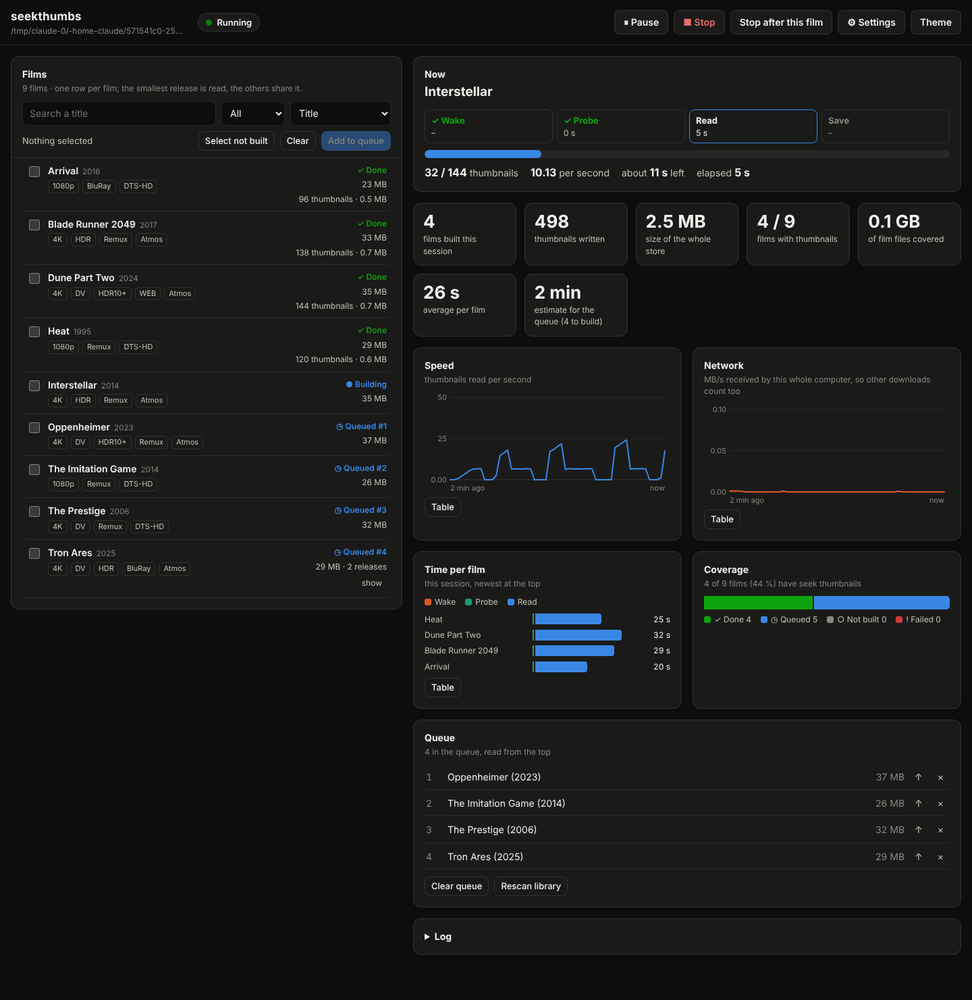

# Usage

## The CLI

```bash
./seekthumbs.py probe "/path/to/one/film.mkv"     # seconds and MB received per thumbnail for each extractor, and the projected time for 100 such films
./seekthumbs.py plan                              # lists what would be built (directory listings only)
./seekthumbs.py scan --max-films 1                # build one film, look at the result (settings work before or after the subcommand)
./seekthumbs.py build "/path/to/one/film.mkv"     # what the viewer starts when you play a film with no thumbnails: one film, low priority, 2 reads at a time
./seekthumbs.py scan                              # the whole library, as fast as the mount allows (run it overnight; Ctrl+C is safe, it resumes)
./seekthumbs.py status                            # size per 2 h against the 10 MB budget
./seekthumbs.py install-service --enable          # afterwards: the background watcher picks up new films (systemd user service)
./seekthumbs.py install-viewer                    # the mpv side, into ~/.config/mpv-object-audio/scripts; sets build=no (the viewer only shows thumbnails)
./seekthumbs.py install-viewer --on-play          # same, and turns the on-play build on (records builder= and build=yes); see the warning below
./seekthumbs.py refine --interval 10 --dry-run    # which films, and how many thumbnails each still needs, for a finer interval
./seekthumbs.py refine --interval 10              # read only those; thumbnails already on the new grid are kept
./seekthumbs.py verify                            # flags anything over the per-film budget
```

Every setting can also be given on the command line, before or after the subcommand (`./seekthumbs.py scan --max-films 1`). `prune` is manual and deletes (`--yes` to actually delete); it never deletes a pack that an alias still uses.

`watch` loops: it lists the library (directory listings only), queues films with no entry or whose size changed (newest first), builds at most 3 per pass, then sleeps for `poll` (30 min). Files under `min_size_mb` are ignored; files modified in the last 10 minutes are skipped. If the library folder is empty or missing, the pass does nothing, so a dead mount doesn't look like "all films deleted."

## The web page

```bash
./seekthumbs.py serve            # prints an address with a one-time token; open it in your browser (add --open to do that for you)
```

It listens on 127.0.0.1 only, every request needs the token, and the `Host` header must be this computer. It reads the library and writes the thumbnail store, nothing else, and it cannot name an arbitrary file — only pick films that seekthumbs itself listed.

One row is shown per film; its releases are grouped, and the smallest one is read in full. Every other release of that film can only become an alias (a few seconds to check) if its runtime is within `share_tolerance` (2 s) of the one already built; otherwise that release is left out and gets its own set when you play it or build it directly. A film counts as Done once any release has a set; the release list shows which ones do.

**Building a specific release.** Expanding a film that has several releases shows each one with a status icon and, for a release that isn't done, queued or already running, a **"+ build this one"** button. Its tooltip explains it: it builds that exact release on its own, even though another release of the same film already has thumbnails. This is for when the shared/aliased release isn't the one you actually want thumbnails for.



*Screenshot of the page running on a small library of synthetic films (so the sizes and times are tiny).*

Tick the films you want, press **Add to queue**, then **Start**. The buttons:

- **Pause** freezes the reads where they are; **Resume** carries on from the same thumbnail.
- **Stop** ends now and throws away the film currently being read (it goes back to the top of the queue).
- **Stop after this film** finishes the current film, then stops.
- The settings pop-over changes the parallel reads, the rest after each read, and whether it waits while a player runs, from the next film on (nothing is written to your config file).

The panels show the phase of the film being read (wake, probe, read, save), thumbnails per second, the network speed of the whole computer (so other downloads count), how long each finished film took and where the time went, the size of the store, and how much of the library is covered. Every chart has a Table view, and the log is at the bottom.

The queue is saved in the store (`.web-queue.json`), so closing the page keeps it. The film currently being read is recorded there too, so if the page is killed mid-film it comes back at the top of the queue on the next start instead of being lost.

Do not run `scan` or `watch` at the same time as a Start from the page — one film is never built twice, but the two would compete for the mount.

## The mpv viewer

`install-viewer` installs `thumbfast.lua` into mpv's `scripts` folder (the folder it prints; `~/.config/mpv-object-audio/scripts` for this project's mpv, or `~/.config/mpv` for plain mpv), moving aside any real `thumbfast.lua` as `.bak` — this script replaces it, answering the same seek-bar hover messages from the local thumbnail store instead of opening the film in a second mpv.

Settings for the viewer live in `script-opts/seekthumbs.conf` next to that `scripts` folder: `library`, `store` and `min_size_mb` are read from the main `config.ini`, and this file can override them, plus `overlay_id`, `ffmpeg`, `debug=yes`, `build=no`/`build=yes`, `builder=` (set by `install-viewer`), `python=`, `recheck_s`.

**On-play build.** When the playing file is a video under `library`, at least `min_size_mb`, and has no usable thumbnail entry, the viewer starts a background build of that one file through mpv's detached `run` (it never blocks mpv), once per file per session. Nothing is shown until it finishes; the viewer checks again every 10 s and tells uosc as soon as the entry exists (hovering also re-checks, at most every 5 s). The first play of a film has no thumbnails for the first few minutes; later plays do.

`build=no` turns the on-play trigger off; `install-viewer --on-play` writes `builder=<path to seekthumbs.py>` and `build=yes`; plain `install-viewer` writes `build=no`.

!!! warning "On-play build is off by default"
    On the author's rig, an on-play build on a 4K remux read about 66 MB/s from the debrid mount for as long as it ran. Because of that measurement, the on-play trigger is off by default; turn it on only with `install-viewer --on-play`, and be aware of what it can cost on a metered or rate-limited mount.

After a `git pull`, run `./seekthumbs.py install-viewer` again — `install-viewer` *copies* `thumbfast.lua` into mpv's scripts folder, so an update to the script in this repository doesn't reach mpv until you reinstall it.

## Settings (`config.ini` `[seekthumbs]`, or `--option` on the command line)

`library`, `store`, `interval` (20 s between thumbnails), `width` (400 px), `workers` (6, parallel reads for batch builds), `extractor` (`auto` | `pyav` | `ffmpeg`), `rate_cooldown` (30 s), `pause` (0), `film_pause` (0), `poll` (1800 s, for `watch`), `settle` (600 s), `min_size_mb` (300), `skip_tv` (0; 1 = leave out files whose name has an `S01E02`-style episode tag), `exclude` (empty; a case-insensitive regular expression matched against the path relative to the library, `|` for several), `max_films` (0 = all), `budget_mb` (10, per 2 h of film), `safety` (0.8), `seek_timeout` (30 s), `yield_to_playback` (1), `breaker_hours` (1).

For the on-play build and release sharing: `play_workers` (2), `play_pause` (2 s), `play_extractor` (`pyav` | `auto` | `ffmpeg`), `share` (1; 0 = one set per file, no aliasing), `share_tolerance` (2 s), `encode_jobs` (0 = all CPUs; the on-play build uses 2 unless set), `worker_mem_mb` and `mem_reserve_mb` (the memory guard, see the README), `read_url_base` (read thumbnails over HTTP range requests instead of the mount — see the README for details and the measurements behind it), `http_chunk_kb` (bounds each HTTP request to this many KB when `read_url_base` is set; default 1024, 0 restores the old open-ended behaviour), `max_mb_per_thumb` (default 150; judged on a rolling recent window, not the release's lifetime average, so a release that reads cleanly at first and only later turns pathological is still caught - a release is abandoned and recorded as a failure once either at least 3 recent thumbnails averaged worse than this, or a progress tick passed with zero new thumbnails and 3x this much received; 0 turns it off), `daily_budget_gb` (default 150; 0 turns it off) and `budget_tz` (default `Europe/Berlin`).

**Films with no seek index.** Some remuxes have no Cues element at all, which otherwise forces a scattered, expensive search for every single seek (see "Bounded reads do not help every file" in the README). `no_index` (default 1) turns on a calibrated, index-free read path for exactly those films — it predicts where in the file a timestamp should be, reads only the one small piece of the file it needs to check, and gets more accurate as the film is built; a file that does have an index never touches this path at all, and any read this path can't resolve confidently falls back to the normal one. `no_index=0` restores the exact pre-existing behaviour. See the README's "Calibrated seeking for files with no Cues at all" entry for the full design, and `noindex.py`'s own module docstring for the mechanics.

**Cold files.** On a debrid mount the first touch of a file can take 20 s or more before any data arrives (with the network almost idle), then reads in the same file are fast. So before probing a film, seekthumbs reads 1 MB at the start and end of the file to wake it (`probe_timeout`, 300 s, is how long it waits), wakes the next `wake_ahead` (3) files in the background so those waits overlap, and a file that is still not answering is skipped, tried again at the end of the pass, and never recorded as a failure on the first timeout. The "built" log line shows the wake, probe and read seconds of each film; while a film is read, a line every `progress_every` (60) seconds shows the count, the rate and the time left.

See the README's "How it works" and "Settings" sections for the reasoning and the real-world measurements behind each default — several of these numbers (byte cost per thumbnail, memory per worker, daily budget) come from the author's own rig and mount and are explicitly not guaranteed to transfer to a different one.

## Troubleshooting / known weak spots

The README keeps a running list of what has and hasn't been verified in real use (as opposed to under a mocked mpv or a synthetic test library) — worth reading before relying on this in a real room:

- The hover preview is confirmed in real mpv with uosc; the on-play trigger and the late-appearing-thumbnail behaviour are only checked under a mocked mpv API.
- Bytes read per seek depends heavily on the mount (rclone flags, or whether the file has an intact seek index at all — see "Bounded reads do not help every file" in the README).
- Rate-limit detection is by matching error text and timeouts; a backend that throttles silently is only caught by the 90 s timeout.
- Dolby Vision profile 5, and HDR through PyAV on a real HDR file, are untested.
- If `probe` or the first film built shows throttling, lower `--workers`.
- The web page itself was tested against a synthetic library in a headless browser (light, dark and phone width, no console errors) and with unit tests; the owner ran it on the real mount once (it ran; no numbers recorded yet). Not covered: a real mpv running while the page waits for it (the "wait while a player runs" setting), and very long runs.

The full, up-to-date list — including specific measurements from the author's own debrid mount — is in the project [README](https://github.com/praveenchandrahas/seekthumbs#not-verified-yet--known-weak-spots).
